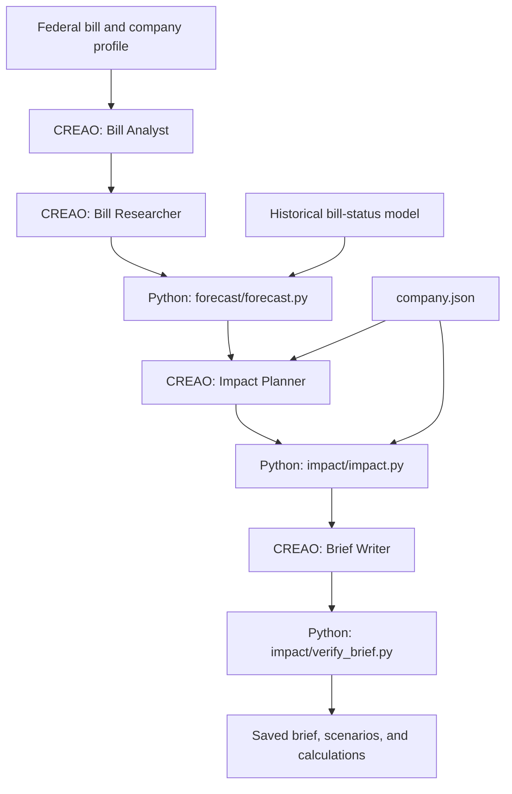
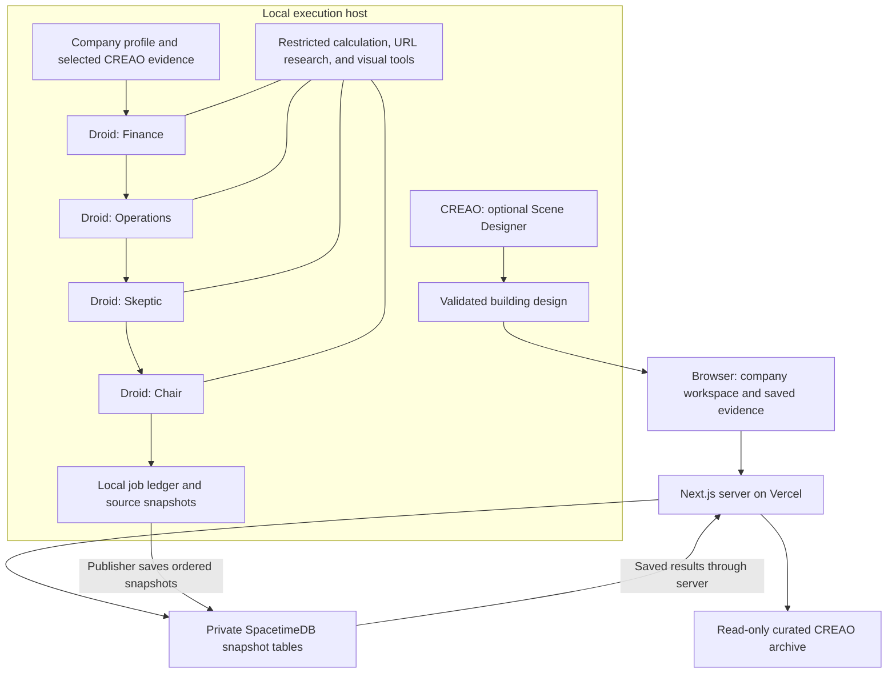

# Consul

Consul turns federal policy evidence into a business decision. It combines a company workspace, a bill-analysis pipeline, and a council of AI advisers that debate the evidence before a Chair recommends an action.

[Open the live demo](https://consul-calhacks13.vercel.app) to explore VoltRide, a fictional e-bike company facing battery-policy decisions. The public deployment opens the saved workspace without signup. It serves recorded results; reading a page does not start a paid agent run.

## Explore the demo

- `/` opens the VoltRide workspace, its interactive 3D building, and business departments.
- `/demo` lists the available company examples.
- `/demo/voltride` opens VoltRide directly.


Open **Consul** in a workspace to inspect the saved debate, decision, and cited evidence. Open the agent cards to read archived CREAO conversations and download their artifacts. The public agent API serves the reviewed dataset in [`web/src/demo-data/agent-evidence.json`](web/src/demo-data/agent-evidence.json), never the provider's full account history.

The demo separates example inputs from actual execution. Company profiles, supplier assumptions, and some department figures are fictional samples. Other workspace figures derive from the entered company setup. The archive includes six completed CREAO runs with thirteen artifacts, plus saved responses from actual Factory Droid sessions. Model-generated output is still a claim to inspect, even when its execution is real. Saved examples do not establish current legislative status.

## Bill analysis architecture

The pipeline divides language work from calculation. CREAO agents extract requirements, research context, propose company strategies, and write a brief. Python calculates passage probabilities and the financial effects of each strategy.



[`backend/pipeline.py`](backend/pipeline.py) runs this chain and saves each stage. The brief verifier checks numerical support against the supplied analysis and calculation outputs. It does not verify the truth of the original sources or the completeness of an agent's interpretation.

The forecast model uses bill-status snapshots from the 117th and 118th Congresses, covering 31,268 House and Senate bills and 627 enactments. It learns separate models for three legislative stages and uses a fixed estimate after both chambers pass a bill. Signals include time remaining, cosponsors, party control, and companion bills. Historical performance does not establish calibration for every future Congress. Text enacted inside another bill also falls outside the model's bill-level success label.

The impact calculator compares annual profit changes, one-time costs, supplier capacity, certification timing, and readiness across scenarios. Its expected value depends on the forecast and the company's assumptions. It treats products as unsellable while required fixes remain incomplete and omits costs before the rule applies. These are scenario calculations, not verified company accounts.

## Council, persistence, and deployment

The Council asks four Factory Droid sessions to speak in order. Finance develops a position, Operations responds, Skeptic challenges the preceding positions, and Chair publishes a cited decision. Each later role receives the earlier public responses. The optional CREAO Scene Designer produces the workspace's building design independently of this debate.



The SDK runner gives each seat dedicated tools for JavaScript calculations, trusted Python calculations, public HTTPS source reads, and visual artifacts. Native shell, file, and browser capabilities are disabled. JavaScript runs in QuickJS with memory and execution limits. Provider credentials stay on the execution host.

Council validation checks output structure, known citation IDs, and literal supporting excerpts for numeric claims. Those checks establish traceability, not semantic truth. Source text remains available for inspection. Follow-ups retain frozen evidence and require the exact company profile, so a citation cannot silently refer to a different source or company.

The local ledger reserves request IDs before execution. Repeated submissions with the same ID and payload recover the existing job. A process restart does not automatically rerun unfinished paid work.

SpacetimeDB preserves full Council snapshots across web deployments. Its tables are private, and its reducer permits writes only from the publisher identity. Immutable ownership and company scope, strictly ordered revisions, and idempotent saves prevent stale or conflicting snapshot updates. This archive does not coordinate distributed workers. The Next.js server holds the archive credential and restricts reads to the appropriate scope or deliberately shared demo sessions.

Vercel serves the interface and reads the archive. Python analysis, the Droid CLI, and new paid Council runs remain local. The public release uses `CONSUL_JUDGE_DEMO=true`; signup and private-account deployment require separate backend configuration. ElevenLabs supplies offline narration for the demo video, rather than runtime voice interaction.

## Run locally

Use Node.js 24.22.1 or newer, pnpm 10.26 or 11, and Python 3. From the repository root:

```powershell
Set-Location web
pnpm install --frozen-lockfile
if (-not (Test-Path .env)) { Copy-Item .env.example .env }
pnpm dev
```

If `web/.env` already exists, keep it instead of copying over it. Open `http://127.0.0.1:3000`. The local development routes `/demo/council` and `/demo/scenes` preview Council layouts and building designs; production disables those routes. The example environment enables the saved-demo entry. Configure the three server-only `SPACETIMEDB_*` values to read a hosted Council archive. Without them, the archive reports unavailable.

To run the saved bill pipeline without provider calls, use a second terminal at the repository root:

```powershell
python backend/pipeline.py hr 973 --companion s389 --demo
```

This command reuses saved CREAO outputs and writes a new `runs/` folder. To call the live bill agents, configure the per-agent credentials in `backend/.env` from its example and omit `--demo`.

For live local Council execution, configure `FACTORY_API_KEY`, `DROID_EXECUTABLE`, `COUNCIL_MODEL_ID`, `COUNCIL_REASONING_EFFORT`, and `ENABLE_LOCAL_AGENT_PREVIEW=true` in the ignored `web/.env`. Configure the app-scoped CREAO keys when selecting provider evidence. Keep credentials out of browser variables and Git. Follow the [backend and Council setup guide](backend/README.md#consul-council) for model discovery, source selection, API commands, and recovery rules.

## Maintain the project

| Location | Responsibility |
| --- | --- |
| [`web/`](web/) | Next.js interface, 3D workspace, agent API, and Council runner |
| [`agents/`](agents/) | CREAO instructions and JSON contracts |
| [`backend/`](backend/) | Python pipeline orchestration and provider client |
| [`forecast/`](forecast/) | Passage model, training code, and model data |
| [`impact/`](impact/) | Scenario calculations and brief verification |
| [`spacetimedb/`](spacetimedb/README.md) | Private snapshot module, adapter contracts, and archive tools |
| [`company.json`](company.json) | Fictional VoltRide calculation inputs |

Read [deployment settings and boundaries](DEPLOYMENT.md) before publishing. Use the [backend guide](backend/README.md) for live agent operations and the [archive guide](spacetimedb/README.md) for persistence changes.
